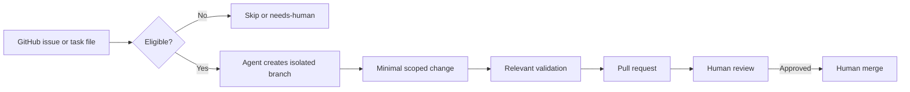

# AI Nightshift

AI Nightshift is a reusable orchestration framework for cloud AI coding agents. It turns explicitly approved GitHub tasks into isolated, reviewable pull requests while keeping human review mandatory.

The project focuses on agent orchestration, task lifecycle management, safety guardrails, validation, and GitHub-native workflows rather than on autonomous production changes.

**Demonstrates:** AI agent orchestration · GitHub workflow design · human-in-the-loop automation · safety guardrails · Node.js validation · GitHub Actions

## How it works



The agent never merges automatically. Tasks must be explicitly marked as ready, small, and safe before implementation.

## Example lifecycle

A typical low-risk task looks like this:

```text
Issue: Fix mobile navbar overflow
Labels: ready-for-agent, small, safe-change, risk-low
        ↓
Agent validates scope and constraints
        ↓
Branch: agent/42-fix-mobile-navbar
        ↓
Minimal implementation + relevant checks
        ↓
Pull request with validation and risk notes
        ↓
Human review and merge decision
```

This example is illustrative only; the public template should not contain real client, roadmap, or private project tasks.

## Quick start

1. Create a new repository from this template.
2. Keep your working queue private.
3. Create the recommended labels from `labels.yml`.
4. Connect the private queue and approved target repositories to your cloud coding agent.
5. Create tasks as GitHub issues.
6. Schedule the instruction in `NIGHTSHIFT.md`.
7. Review every agent-created pull request manually.

See `docs/setup.md` for the full setup and repository settings.

## Design decisions

### Human review is a hard boundary

AI Nightshift prepares work but does not decide final acceptance. Agents create branches, commits, pull requests, comments, and analysis results; humans decide whether code is merged.

### Explicit readiness beats autonomous prioritization

Only tasks explicitly marked `ready-for-agent` are eligible. The agent may order already-approved work, but it does not decide business priorities or promote arbitrary backlog items into execution.

### One task, one branch, one reviewable outcome

Implementation tasks use one dedicated branch and one pull request. Analysis-only or blocked tasks end with a recorded result rather than silent partial work.

### Public template, private queue

The reusable framework can be public. The actual working queue should normally be private because issues and pull requests may contain project names, roadmap details, screenshots, private links, and implementation context.

## What is implemented vs. policy

AI Nightshift deliberately separates executable automation from operating conventions.

**Implemented in this repository:**

- Node.js validators for task files and repository consistency
- GitHub Actions validation
- structured GitHub issue templates
- reusable task, PR, result, and morning-review templates
- label definitions

**Defined as operating policy for connected agents:**

- task eligibility and queue ordering
- branch-per-task behavior
- PR-per-implementation-task behavior
- safety boundaries and escalation rules
- human review requirements
- stop conditions and context-budget discipline

The repository itself is not a hosted agent runtime. It is the control layer and reusable protocol used by an external cloud coding agent.

## Intended use

Use this repository as a starting point for a private personal queue.

Recommended setup:

1. Create a new repository from this template.
2. Make your copy private.
3. Create the recommended GitHub labels in your private copy.
4. Connect the private copy to your cloud coding agent.
5. Connect any target repositories the agent is allowed to work on.
6. Create tasks as GitHub issues.
7. Review all agent-created pull requests manually.

Do not store personal tasks, client names, invoices, private URLs, or internal project details in the public upstream repository.

## Works with

The workflow is agent-agnostic. It can be adapted for any cloud coding agent that can read GitHub issues or files and create branches or pull requests, including Codex-style agents, Cursor-style agents, Claude Code-style workflows, or custom GitHub-connected agents.

## Core workflow

```text
During the day: capture coding todos as GitHub issues or task files.
Before the night run: mark safe, clear tasks as ready-for-agent.
At night: the agent processes as many eligible ready tasks as practical during the available run.
After each task: the agent records the result and removes the task from the ready queue.
In the morning: review PRs, comments, skipped tasks, and questions.
```

## Non-negotiable rules

- Never merge automatically.
- Never push directly to `main` or `master`.
- Create one branch per task.
- Create one pull request per implementation task.
- Only process tasks explicitly marked `ready-for-agent`.
- Never process tasks already marked `agent-done`, `pr-open`, `agent-in-progress`, `agent-skipped`, `needs-human`, `blocked`, or `agent-error`.
- Skip ambiguous, risky, or broad tasks.
- Do not touch identity, payment, data migration, deployment, or production configuration without explicit human approval.

## Recommended labels

| Label | Meaning |
|---|---|
| `ready-for-agent` | The task is approved for an agent run. |
| `small` | The task should fit in a small isolated PR. |
| `safe-change` | Low-risk change, usually UI, copy, CSS, docs, or a local bugfix. |
| `no-autocode` | Agent may analyze only, not modify code. |
| `bounded-analysis` | Analysis task has a limited inspection scope. |
| `needs-human` | Task is blocked by missing context or decision. |
| `priority-high` | Process before other ready tasks. |
| `blocked` | Do not process until unblocked. |
| `agent-in-progress` | Agent is currently processing this task. |
| `pr-open` | A pull request has been opened for this task. |
| `agent-done` | Agent completed a PR or final answer. |
| `agent-skipped` | Agent intentionally skipped the task. |
| `agent-error` | Agent hit a tooling, permission, or runtime error. |
| `risk-low` | Low-risk task. |
| `risk-medium` | Medium-risk task. |
| `risk-high` | High-risk task; human approval required. |

GitHub does not automatically create repository labels when a repository is created from a template. After creating your private copy, install GitHub CLI and run this from PowerShell, replacing `OWNER/YOUR-NIGHTSHIFT-REPO` with your copied repository name:

```powershell
$repo = "OWNER/YOUR-NIGHTSHIFT-REPO"

$labels = @(
  @{ name="ready-for-agent"; color="0E8A16"; description="Approved for an AI coding agent run" },
  @{ name="small"; color="C2E0C6"; description="Small isolated task" },
  @{ name="safe-change"; color="BFDADC"; description="Low-risk change suitable for autonomous PR preparation" },
  @{ name="no-autocode"; color="FEF2C0"; description="Analysis only; do not modify code" },
  @{ name="bounded-analysis"; color="D4C5F9"; description="Analysis task has a limited inspection scope" },
  @{ name="needs-human"; color="D93F0B"; description="Missing context or decision required" },
  @{ name="blocked"; color="B60205"; description="Do not process until unblocked" },
  @{ name="priority-high"; color="FBCA04"; description="Process before other ready tasks" },
  @{ name="agent-in-progress"; color="1D76DB"; description="Agent is currently processing this task" },
  @{ name="pr-open"; color="5319E7"; description="A pull request has been opened for this task" },
  @{ name="agent-done"; color="0E8A16"; description="Agent completed the requested deliverable" },
  @{ name="agent-skipped"; color="7057FF"; description="Agent intentionally skipped the task" },
  @{ name="agent-error"; color="B60205"; description="Agent hit a tooling, permission, or runtime error" },
  @{ name="risk-low"; color="C2E0C6"; description="Low-risk task" },
  @{ name="risk-medium"; color="FEF2C0"; description="Medium-risk task" },
  @{ name="risk-high"; color="D93F0B"; description="High-risk task; human approval required" }
)

foreach ($label in $labels) {
  gh label create $label.name `
    --repo $repo `
    --color $label.color `
    --description $label.description `
    --force
}
```

To check the result:

```powershell
gh label list --repo OWNER/YOUR-NIGHTSHIFT-REPO --sort name --limit 100
```

## Repository map

```text
.github/
  ISSUE_TEMPLATE/       GitHub issue forms for structured tasks
  pull_request_template.md
  workflows/            CI validation
docs/
  setup.md
  operating-model.md
  agent-integrations.md
  privacy.md
  publication-checklist.md
  safety-policy.md
  task-taxonomy.md
  review-checklist.md
  cost-control.md
scripts/
  validate-tasks.mjs
  validate-repository.mjs
  validate-tasks.test.mjs
templates/
  task.md
  pr-body.md
  morning-review.md
  agent-result-comment.md
tasks/
  inbox/
  archive/
AGENTS.md               Primary instructions for AI coding agents
NIGHTSHIFT.md           Nightly execution prompt and operating checklist
SECURITY.md             Security reporting and sensitive-data guidance
labels.yml              Suggested GitHub labels
```

## Task format

Use GitHub issues when possible. Use Markdown task files only for quick capture or when issue creation is inconvenient.

A good task contains:

- target repository
- target branch
- files or area likely affected
- exact problem
- expected result
- constraints
- validation steps
- risk level

Example:

```md
# Fix mobile navbar overflow

Target repo: OWNER/example-project
Target branch: main
Area: src/styles.css
Type: bugfix
Risk: low

## Problem
The navbar overflows horizontally under 390px viewport width.

## Expected result
No horizontal scroll. Buttons remain readable.

## Constraints
- Do not redesign the navbar.
- Do not change JavaScript.
- Only touch CSS unless absolutely necessary.

## Validation
- Check 360px, 390px, and 430px widths.
- Run only relevant checks if available.
```

## Nightly automation prompt

Use the prompt in `NIGHTSHIFT.md` as the scheduled agent instruction.

Default recommendation:

```text
Process eligible tasks until the ready queue is empty or the available run can no longer safely continue.
Only process issues or files marked ready-for-agent + small + safe-change.
Create branches and PRs only.
Never merge.
Record each task result before starting the next task.
Remove ready-for-agent after completion, skip, or needs-human.
```

## Morning review

Every morning, review:

1. PRs created overnight.
2. Tasks completed, skipped, or marked `needs-human`.
3. Tasks with `agent-error`.
4. Test results and validation notes.
5. Any files changed outside the requested scope.
6. The reason the run stopped.

## Documentation

- `docs/setup.md` — installation and recommended repository settings
- `docs/operating-model.md` — lifecycle, boundaries, and queue behavior
- `docs/agent-integrations.md` — requirements for cloud agents and custom integrations
- `docs/safety-policy.md` — restricted areas and escalation behavior
- `docs/privacy.md` — public-template/private-queue separation
- `docs/task-taxonomy.md` — suitable, unsuitable, and analysis-only task categories
- `docs/review-checklist.md` — morning human-review checklist
- `docs/cost-control.md` — context and compute discipline
- `docs/publication-checklist.md` — checks before publishing a clean public template

## Scope philosophy

AI Nightshift should reduce unfinished micro-work, not become an unsupervised engineering system. The agent is allowed to execute clear, low-risk tasks. It is not allowed to decide business priorities, redesign products, alter critical infrastructure, or merge into production branches.

## License

MIT.